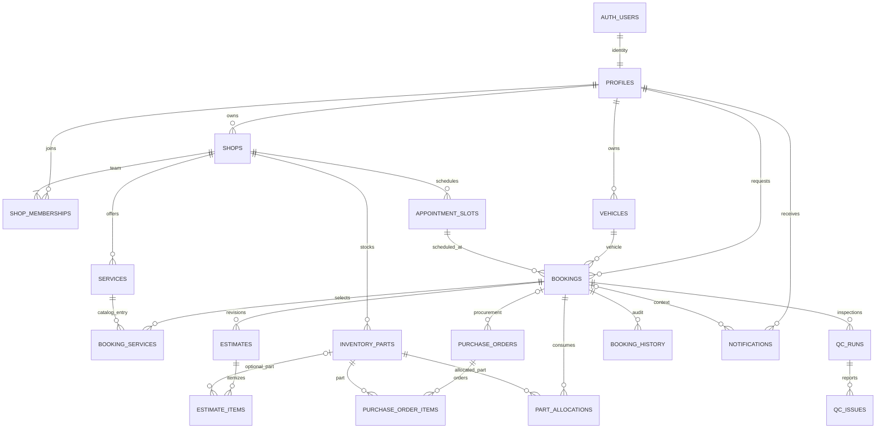

# B01 Database Foundation

B05 adds a private CREATE_BOOKING receipt table and atomic booking RPC without
changing the 18 public tables or their RLS policies. Its migration is local-only
until the operator applies it manually; see [B05 verification](b05-booking-verification.md).

B04 adds owner catalog RPCs and safe public capacity; see
[B04 verification](b04-catalog-verification.md) for migration and approval status.
B03 adds narrowly guarded auth/profile/team RPCs without changing B01 read
policies or direct table write denial. Its forward migration and Cloud approval
status are recorded in [B03 verification](b03-auth-verification.md).

The full master blueprint was reread before implementation. The current user
explicitly moved database tooling under `backend/` and included foundation RLS,
helper functions and seed fixtures in B01. No HTTP server, routes or workflow
operations are implemented here. Next.js will live under `frontend/`.

## Reproducible Supabase Workflow

Prerequisites: Node.js 22 or later. Docker is not required or installed. Dependencies
are locked in `backend/package-lock.json`. The Supabase CLI is pinned to 2.120.0.
Configuration was generated using `supabase init`, then explicitly hardened.

From repository root, in PowerShell:

```powershell
Set-Location backend
npm ci
npm run db:reset
npm run typecheck
```

`db:reset` creates a fresh native PostgreSQL 17 cluster on loopback, runs the
official `supabase db reset --db-url <temporary-loopback-url> --yes`, runs the
tests, preserves existing types, verifies the second migration application is a no-op,
and shuts down/removes the cluster. `db:verify:postgres` is an alias for the same
verification. The URL is generated inside the script and cannot be replaced by
an environment variable or argument. It applies ordered migrations and
`supabase/seed.sql`. **The CLI labels all explicit database URLs as "remote",
including this 127.0.0.1 URL; this script never resets Supabase Cloud.**
Never pass `--linked` or a Cloud URL to reset. To add
schema changes, run `npx --no-install supabase migration new descriptive_name`
and edit the generated file. Application DDL belongs only in migrations.
`seed.sql` contains DML only, as the explicit seed exception in the work order.
Tests are JavaScript, with transactional SQL assertions; they roll back fixtures.

Cloud application is a separate operator step after migration review:

```powershell
npx --no-install supabase login
npx --no-install supabase link --project-ref YOUR_PROJECT_REF
npx --no-install supabase migration list
npx --no-install supabase db push --dry-run
# Review the SQL, grants and Cloud target before explicitly applying:
npx --no-install supabase db push
```

Do not include the seed in Cloud pushes. Use Auth Admin tooling for a separately
authorized disposable Cloud demo in B11. No Cloud project was linked or changed
by the original B01 implementation. The user subsequently linked Cloud project
`tlqvlsrmxueuuzxyltej`; B01-B06 are applied and verified in Cloud. B02 verified
real Auth/REST using separate security fixtures, not the local seed or B11 demo.
Keep passwords, access tokens and database URLs out of Git and chat.

After reviewed Cloud migration application, `npm run db:lint` lints the linked
database and `npm run db:types` regenerates types from the linked project.
Cloud lint/type generation are read-only. `db:test` runs SQL assertions against an
already running loopback test database (`BAYFLOW_TEST_DB_URL`); the self-contained
`db:reset` command is the convenient local entry point.

The user explicitly declined Docker. `supabase start` and `supabase db reset
--local` use the container-based Supabase stack on Windows, so they are not the
chosen workflow. The native harness verifies PostgreSQL schema/RLS but does not
run Supabase Auth, PostgREST, Storage or Studio. Cloud remains the app backend.

## Migrations

| Version | Contents |
| --- | --- |
| `20261009090000_identity_and_catalog.sql` | Five enums, identity/shop/catalog tables, owner consistency, timestamps |
| `20261009090100_workflow_relations.sql` | Remaining workflow tables, composite FKs, checks, indexes, subtotal validation and append-only history |
| `20261009090200_tenant_read_policies.sql` | Private read predicates, 18 read policies, explicit grants and three safe public views |

Each migration is transactional. Migrations are applied once by the CLI ledger;
reapplying the raw SQL is intentionally unsupported. Use a fresh local reset or
new forward migration. Never edit already-deployed migrations.

## Relationships



There are 18 application tables. UUID primary keys identify every record;
composite unique keys support same-shop foreign keys. Global profiles and vehicles
have no shop ID. `shops.id` is the tenant ID; every other shop-owned table carries
`shop_id`, including estimate and purchase-order lines. Notifications may be global
only when both shop and booking context are absent.

An owner can own many shops, with exactly one active OWNER membership per shop
matching `shops.owner_user_id`. Deferred checks permit atomic creation of both
records. Shop staff have one role per `(shop_id,user_id)`; an identity can hold
different roles in different shops. Role values are OWNER/SA/TECHNICIAN/PARTS/QC.
CUSTOMER is represented by global identity and booking ownership.

Bookings reference `(customer_id,vehicle_id)` and `(shop_id,slot_id)`; assignee
FKs reference memberships in the same shop. Every repair/procurement relation
has matching-shop FKs. QC issues additionally bind the run to the exact booking.
No cascade removes business data. Staff and catalogs are deactivated, and audit
records cannot be updated, deleted or truncated through ordinary DML.

All currency columns are integer whole PKR; quantities are integers. Generated
line totals reject arithmetic overflow. A deferred subtotal constraint validates
the sum of item totals at transaction end; later RPCs must compute it from lines
and lock the estimate before editing. No customer-supplied total is authoritative.
An active allocation is unique per booking/part. One unfinished QC run is allowed
per booking. The actual stock, receipt, claim and release operations remain later
workflow work, with transactional authorization and idempotency.

`timestamptz` stores instants; shop display defaults to Asia/Karachi. `updated_at`
triggers use statement time. Append-only events have only creation/event times.
Working hours and QC checklists use JSON objects; semantic validation of their
contents belongs to the later settings and QC contracts.

## RLS And Grants

RLS is enabled on all 18 tables immediately upon creation. Ordinary `anon` and
`authenticated` roles receive no INSERT/UPDATE/DELETE/TRUNCATE privileges. B01
has no public RPCs and no write policies. Later operations must be narrowly
granted authenticated SECURITY INVOKER entry points delegating to guarded private
implementations, as required by the blueprint.

All six read helpers live in unexposed `private`, are SECURITY DEFINER with empty
search paths, use fully qualified relations, and bind identity to `auth.uid()`.
They evaluate predicates only and cannot mutate data. Their execute grants go
only to authenticated. Trigger helpers are not executable by ordinary users.
This avoids recursive membership and booking policies.

| Data | Authenticated read scope |
| --- | --- |
| Shops, services, slots | Private base rows only for active same-shop members |
| Memberships | Own active membership, or same-shop OWNER/SA roster |
| Profiles | Self, authorized job customer, or OWNER/SA same-shop roster |
| Vehicles | Self-owned, or vehicle attached to an authorized staff job |
| Bookings | Owning customer; active OWNER/SA; assigned tech/parts; QC unclaimed queue or own claim |
| Estimates and items | Authorized job context; customers/parts/QC see only SENT/APPROVED/REJECTED snapshots |
| Inventory and purchase orders/items | Active OWNER/PARTS in that shop |
| Allocations, QC runs/issues, history | Authorized booking context |
| Notifications | Recipient AND active tenant membership or owning customer booking; own global alerts permitted |

A customer owning bookings in several shops may read those bookings, but no
unrelated shop data. A technician with the correct shop but no assignment cannot
read that job. Deactivated membership removes staff access immediately.
`service_role` retains administrative privileges and bypasses RLS by design; it
must remain server-only. None of the tests use it as an ordinary user.

`public_shops`, `public_services` and `public_appointment_slots` intentionally use
audited definer views with explicit safe columns and active-shop filters. Anon
has SELECT on these views only. This is the blueprint's explicit projection/grant
design, not an accidental view bypass. Views expose published directory data
across tenants by design, never private booking records or owner IDs. Slot views
show schedules/capacity, not remaining availability; B04 adds that read contract.

## Local Seed Accounts

All addresses end with `@bayflow.example.test`. All disposable accounts use
`BayFlow-Local-2026!`. The SQL stores only bcrypt hashes in Supabase Auth, never
passwords in application tables. Existing IDs/emails are not overwritten and
re-running the seed does not reset passwords. A conflicting email/ID aborts.

| Handles | Scope |
| --- | --- |
| `owner.a` | Lahore Auto Care and Northside Garage |
| `owner.b` | City Motors |
| `customer.a`, `customer.b` | Global customer identities with own vehicle |
| `advisor.a`, `technician.a`, `parts.a`, `qc.a` | Lahore Auto Care |
| `advisor.b`, `technician.b`, `parts.b`, `qc.b` | City Motors |
| `advisor.c`, `technician.c`, `parts.c`, `qc.c` | Northside Garage |

Fixtures include three shops, 16 Auth users/profiles, 15 memberships, three
services, three fixed slots, three inventory parts and two vehicles. No booking,
estimate, order, QC or notification workflow is prefilled. Disposable tests create
and roll back their own job fixtures without pretending to run business actions.
Slots are explicitly dated 2026-10-12; expired fixtures are not live availability.

## Generated Types And Verification

`npm run db:types` invokes `supabase gen types --linked --lang typescript --schema
public`. It validates success and writes via a temporary file so a failed command
cannot truncate previously generated types. The generated artifact belongs to
`frontend/src/lib/supabase/database.types.ts`; no Next.js app is scaffolded.

`npm run db:reset` provides local database verification without Docker. It starts
bundled PostgreSQL 17 on loopback port 55432, creates minimal Auth schema/role
fixtures, applies the actual migrations and seed using the official CLI reset,
runs SQL tests, preserves Cloud-generated types, and
checks that a second migration application is a no-op. It stops the process and
removes the disposable cluster afterward. It never contacts Cloud and is not a
substitute for Supabase Auth/PostgREST integration.

For explicit local type regeneration only, run
`node scripts/verify-postgres.mjs --generate-types`; this invokes official
`supabase gen types --db-url` and replaces the generated artifact. Prefer
`npm run db:types` for the linked Cloud schema.

B02 has now passed real Cloud Auth/PostgREST verification and Cloud lint; see
[B02 evidence and rerun guide](b02-security-verification.md). No additional
migration was required. The review notes below record the original B01 handoff.

Before B02, review migration SQL, intended public view grants, customer estimate
visibility, staff profile access, PostgreSQL major version against Cloud, and the
Cloud Auth/PostgREST smoke test. B00's app/auth/client infrastructure is
still absent and must not be treated as complete.

References: [Supabase local workflow](https://supabase.com/docs/guides/local-development/cli-workflows),
[migrations](https://supabase.com/docs/guides/local-development/database-migrations),
[RLS](https://supabase.com/docs/guides/database/postgres/row-level-security),
[function security](https://supabase.com/docs/guides/database/functions).
